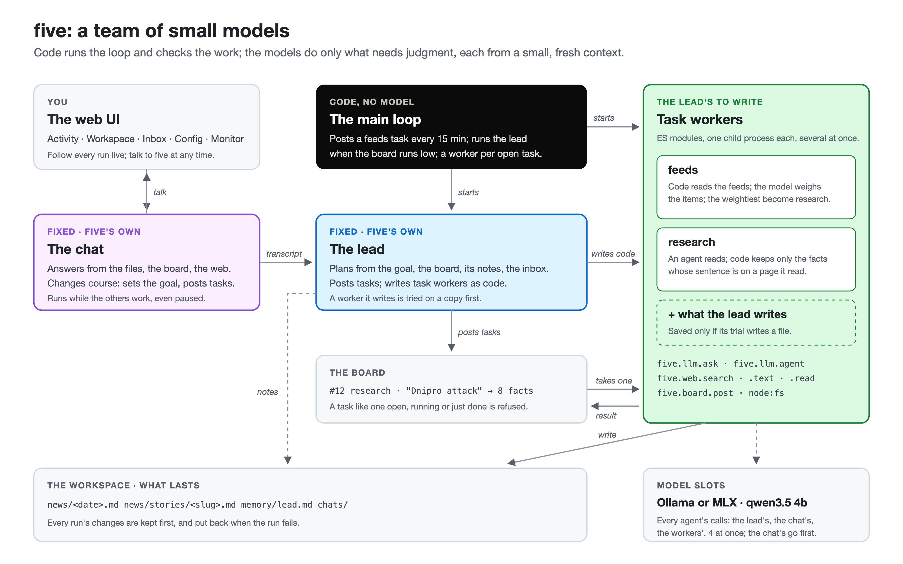
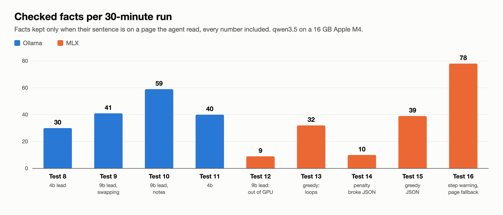
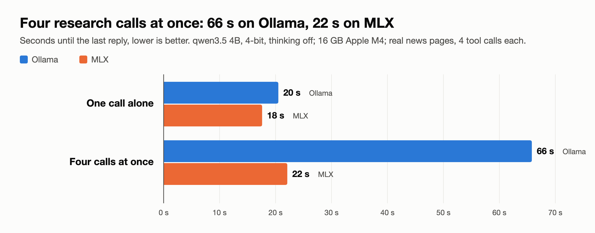

<p align="center">
  
</p>

<h1 align="center">five</h1>

<p align="center">
  <b>A team of small models that never stops.</b><br>
  A lead plans, workers written as code do the work, and code checks every result.
</p>

<p align="center">
  
  
  
  
  
  
  
</p>

five is an experiment in getting real, unattended work out of a 4B model on a
laptop. One big agent with a long context drifts, repeats itself and forgets;
five splits the work instead. Line seven/nine's sibling, and the most minimal
of them: one process, one SQLite file, a local model server.

## The team



- **The main loop is code, not a model.** It decides when the lead plans and
  which worker runs next, so nothing depends on a small model remembering to.
- **The lead plans and writes workers.** Each run starts from a prompt built
  fresh: the goal, the board, its notes, the inbox. It posts tasks, and when no
  worker fits, it writes one: an ES module, tried on a copy of the workspace
  before it is saved.
- **Task workers are code that calls the model.** Code fetches, parses and
  files; the model is asked only what needs judgment, in small calls. Several
  run at once, each in its own process.
- **Code checks what the models say.** A fact is kept only if its sentence is
  on a page the agent read, with every number in it. A task like one already
  on the board is refused. A research task the lead posts must come from the
  news five read. A failed run's file changes are put back.
- **The chat runs beside them.** Talk to five at any time; it answers from
  the workspace and can change the goal, while the others keep working.
- **Contexts stay small.** Every agent starts fresh, only appends, and is
  dropped when done. What lasts is in the workspace and on the board.

`docs/team.svg` is the source of the picture; `docs/team.png` is it rendered at 2×.

## Results

Each test runs five from a clean start for 30 minutes on its news-desk goal,
then counts the facts that passed the checks. The best so far is all on the
4B model: 78 facts in 13 stories, every research run keeping some.



What moved the numbers was mostly not the model but what code does around it:
a lead on the 9B model planned better (tests 9–10) but did not fit beside the
workers in 16 GB; on MLX, sampling greedily made the 4B loop (13), and its
presence penalty broke JSON that Ollama would have constrained (14); telling an
agent two steps before its last, and asking for facts from the pages it read
when its notes give none, doubled what was kept (16).

## How it works

| Part | What it does |
|---|---|
| The main loop | `src/workers/scheduler.ts`, code and no model. Once a second, and whenever a run ends, it starts what there is room for: a task for the `feeds` worker every `feedsEverySeconds` (15 min by default) when none is on the board; the lead when the board has fewer open tasks than `minOpenTasks` (at most every 30 s), when `leadEverySeconds` have passed, or soon after a chat, a goal change or an inbox message; then a task worker for each open task, oldest first, up to `taskRuns` at once. A new five's lead waits for the first result, so it plans from what the workers found rather than from memory. Paused, it starts neither; Stop also ends the lead and task runs in progress. The chat runs either way. |
| Runs | One worker at work: the lead planning, the chat talking, a task worker on one task. Runs are numbered across restarts; every event carries its run's number. A task whose run is cut off by a restart goes back on the board. |
| Model slots | Every model call goes through `src/workers/pool.ts`, which sends at most `slots` at once (match Ollama's `OLLAMA_NUM_PARALLEL`) and queues the rest — the chat's first. On a 16 GB M4, `qwen3.5:4b` keeps about 25 tokens/s per call with 4 at once, but a context not yet in a slot is read one at a time, at about 340 tokens/s for the whole machine: which is why contexts are kept small. |
| Contexts | An agent — the lead, the chat's answer, a task worker's `llm.agent` — starts from a context five builds, only grows by appending (so each call finds the earlier part already in its slot and reads only what is new), and is dropped when the agent is done. What lasts is in the workspace and on the board. Each agent gets only the tools it needs. Near `runTokens` (12000 by default) five tells it to finish; past it, it ends. A long tool result is kept whole in `results/`, and the agent gets its start and the path. |
| The board | Tasks: a worker's name, a title, an input, and when done a short result naming the files where the work is. The lead posts them, as can the chat, a task worker (`five.board.post`), five itself (the feeds) and the person (Board page). A task like one already open, running or done in the last 30 minutes — the same worker and story, or a title saying much the same — is refused: small models post the same task again and again. |
| The lead | Fixed, five's own (`src/workers/lead.ts`). Each run's prompt is built fresh: the goal, the board (open, running, the latest results), the task workers with their counts, its notes (`memory/lead.md`), the person's unread inbox messages and the latest chat. A run that did not update its notes is reminded once, at its end. It posts and cancels tasks, writes task workers, sets the goal, keeps its notes and messages the person (one a run); its own tools are the board's, the workers', the files', `define_library`, `read_library` and `run_js`. |
| Task workers | Code the lead writes with `define_worker`: an ES module whose default export gets `{ task }` and returns the result, run in a child process of its own. It reaches five through `five.llm.ask(prompt, { system, schema })` — one model call, its reply parsed when a JSON schema constrains it — `five.llm.agent({ prompt, tools, maxSteps })`, `five.web.text / feed / search`, `five.web.read()` (what the run's agents read — pages and search results — to check their reports against), and `five.board.post`; Node's `fs` works in the workspace. Code does what code can, the model what needs judgment. A worker that returns nothing, or a placeholder such as `{"done": true}` instead of saying in words what it did, has failed. Five keeps at most `maxWorkers` task workers (4 by default): past it, the lead deletes one before it defines another. A revision of a worker is refused while none of its latest five tasks failed (small models rewrite working code for the sake of it), Every worker the lead defines, new or revised, is first tried once on `test_input` in a copy of the workspace, where it can break nothing; it is saved only if the trial works, and the trial's result says which files it wrote. The lead and the chat cannot be replaced. Libraries (`lib:name`) are bundled in, as for a tool. |
| Seeds | A new five starts with two task workers, the lead's to revise like its own: `research` (a small agent searches and reads, and reports each fact with a sentence copied from its page; code keeps only the facts it finds in what the agent read — the sentence as quoted, or the page's own sentence that has most of the fact's words and every number, which is then the quote — on the page it names first, else any other it read, which becomes the source; it skips those the story has already, and adds the rest under today's date to the story's file in `news/stories/`) and `feeds` (news feeds into today's digest: code fetches, parses and remembers what it has seen; the model picks what matters and weighs it, in batches of 15, with a schema; the three weightiest new items become research tasks). Their sources are in `src/workers/seeds/`. And a goal: a news desk that never closes. |
| The chat | Fixed (`src/workers/chat.ts`). The person's first message opens a chat run with a snapshot of five — the goal, what runs, the board — and its messages are kept while the chat is open. It answers from the files, the board and the web, and changes course when asked (`set_goal`, `post_task`). After an answer it waits `chatWaitSeconds` for the person; then, or when they leave, its transcript goes to `chats/` and the lead reads it at its next run. |
| History | Before a run first changes a file, five keeps the file as it was, in `.five/history/run-<n>/`: the host keeps its own writes (`write_file`, `append_file`), and a worker's child process patches `node:fs` so its code's writes are kept too (`src/runner/keep.ts`, `src/workers/history.ts`). When a run fails, five puts back every file it changed and removes those it made, and says so in the task's error. A file's history is in the Workspace page, where any version can be viewed or put back; putting one back keeps what it replaced. The last 500 runs are kept. |
| Inbox | The lead's messages to the person (`message_person`, with a subject, naming the workspace files it comes from), and the person's to five, which the lead reads at its next run — soon after. |
| Settings | `src/workers/settings.ts`: slots, task runs, when the lead runs, steps and context budget of an agent, result size, image size, chat wait. Changed live on the Config page, kept in the state; the environment gives the defaults. |
| seven's tools | `run_js`, `define_tool`, `start_tool` and the rest, and the tools the agents build, are there for any agent given them by name; `view_image` and `read_pdf` too. Five adds small tools of its own: `read_file`, `write_file`, `append_file`, `list_files` — which leave dot files alone, a task worker's own state such as `news/.seen.json` — `fetch_url` (a page as text, a feed as its items) and `search_web` (DuckDuckGo). |
| The model | Ollama, `qwen3.5:4b` by default, 16k tokens a slot; or MLX (`FIVE_LLM=mlx`). Tool calls a small model writes as text are recovered. |
| State | `<workspace>/.five/five.db`: the event log, the board, the task workers, the goal, the settings, the inbox, tools, libraries, background runs, and whether five was running. |

## Ollama with several slots

Ollama serves several calls at once from one loaded model when
`OLLAMA_NUM_PARALLEL` is set; each slot gets its own context window. The macOS
app does not pass that variable to its server, so run the server yourself:

```sh
OLLAMA_NUM_PARALLEL=4 OLLAMA_HOST=0.0.0.0 OLLAMA_KEEP_ALIVE=30m ollama serve
```

With one slot five still works: the calls wait their turn in Ollama.

## Or MLX, on Apple silicon

`FIVE_LLM=mlx` sends the calls to MLX's server (`mlx_lm.server`, a Python
program run with `uvx`) instead. It decodes concurrent calls together, where
Ollama's slots mostly take turns: four research calls at once (qwen3.5 4B,
4-bit, 16 GB M4) took 22 s with MLX against 66 s with Ollama, 69 against 26
tokens/s.



One server runs one model, so a lead with its own model gets its own:

```sh
make mlx          # the workers' model on :8080 (MLX_MODEL)
make mlx-lead     # the lead's on :8081 (MLX_LEAD_MODEL), with FIVE_LEAD_MODEL set
```

MLX loads what it is asked to, without Ollama's check of free memory; it
cannot constrain a reply to a JSON Schema, so the schema goes in the prompt.

## Web UI

Preact, with seven's and nine's design tokens, polling the API once a second.
A top bar with the sections; each page's contents in one centered column; on a
phone, a bottom tab bar.

| Page | Shows |
|---|---|
| Activity | Five at work. A top bar: what runs, the model's slots as squares (filled while a call runs) and how many calls wait, the board's counts, a filter (all runs, the lead's, tasks, the chat), ‹ last N runs ›, Start / Pause / Stop runs, and the goal. Then every run where it began, newest at the bottom: its worker, task, calls, how it ended. A running run is open, with a pulsing row saying what it does — waiting for a slot, writing, running a tool or its own code — and the model's reply as it streams; a finished one folds to its result, and opens to its prompt, each call with its tool calls and results, and what `llm.ask` asked. Board, goal, worker and inbox events show as lines. At the bottom, the chat: Enter sends, your messages and five's answers show as bubbles, with how long five still waits for you, and **Leave chat** ends it. |
| Board | Every task, newest first: status, worker, title, who posted it, how long it took, and its result or error; opened, its input and whole result. Search, filters by status and worker, **Post a task** for a task worker (its description shown), and Cancel on an open one. |
| Workspace | Four tabs. **Files**: the workspace's files to read and edit, as a grid of cards, searched, filtered and sorted; a SQLite database opens its tables, rows and a SQL view; images and PDFs show. **Workers**: the lead and the chat (five's own, opening to their instructions) and the task workers (revision, tasks done and failed, opening to their code and libraries). **Tools** and **Libraries**: what the agents built, as grids, each opening to its source. |
| Inbox | The lead's messages and yours, newest first, with a box to write to five (⌘↩ sends): the lead reads it at its next run. The nav shows a dot while five has written something you have not seen. |
| Config | The goal, to read and change, and the settings, grouped — model, workers, runs, chat — each with what it does and its default; Apply changes them while five runs, Reset puts them all back. |
| Monitor | Every child process since five started — each `run_js`, tool call, `define_tool` trial, background run and task worker — newest first, with its run and call, state and duration. One shows its error or result, its output (followed live), its arguments and its code; a live one can be killed. |

## Running

| How | Commands | UI |
|---|---|---|
| Docker, Ollama on the host | `make up` · `make logs` · `make down` | `http://<host>:5555` |
| Host, Node ≥ 24 | `npm ci && npm ci --prefix web && make start-host` | `http://127.0.0.1:5555` |
| Working on the UI, beside either | `make ui-host`: the UI from source, reloading as you edit; its API calls go to five on :5555 | `http://<host>:5173` |

Under Docker all data lives in `./workspace`. Configuration is environment
only, but for the settings, which the variables marked *setting* only give
defaults to; `.env.example` lists every variable:

| Variable | Default | Meaning |
|---|---|---|
| `FIVE_OLLAMA_MODEL` | `qwen3.5:4b` | a pulled model with the tools capability |
| `FIVE_LEAD_MODEL` | *(the same)* | the lead's own model, such as `qwen3.5:9b`: it plans on it, one call at a time besides the workers' slots; Ollama needs `OLLAMA_MAX_LOADED_MODELS=2` |
| `FIVE_OLLAMA_ENDPOINT` | `http://localhost:11434` (Docker: `host.docker.internal`) | Ollama |
| `FIVE_LLM` | `ollama` | `ollama`, or `mlx`: MLX's servers; the model names then only label them |
| `FIVE_MLX_ENDPOINT` | `http://localhost:8080` (Docker: `host.docker.internal`) | MLX's server for the workers' model |
| `FIVE_MLX_LEAD_ENDPOINT` | `http://localhost:8081` (Docker: `host.docker.internal`) | MLX's server for the lead's model |
| `FIVE_CONTEXT_TOKENS` | `16384` | the window of each of the model's slots |
| `FIVE_THINK` | `off` | let a thinking model think |
| `FIVE_SLOTS` | `4` | *setting:* model calls at once; match `OLLAMA_NUM_PARALLEL` |
| `FIVE_TASK_RUNS` | `4` | *setting:* task runs at once |
| `FIVE_MAX_STEPS` | `12` | *setting:* model calls in one agent |
| `FIVE_RUN_TOKENS` | `12000` | *setting:* the context budget of one agent |
| `FIVE_FEEDS_EVERY` | `900` | *setting:* seconds between the feeds tasks five posts; 0 for none |
| `FIVE_TICK_MS` | `1000` | how often five looks for work |
| `FIVE_AUTOSTART` | `off` | start the workers at startup even if five was paused |
| `FIVE_RUN_TIMEOUT_MS`, `FIVE_RUN_MEMORY_MB` | `60000`, `1024` | limits of one code run (a task worker's: the `taskTimeoutSeconds` setting) |
| `FIVE_API_ADDR` | `127.0.0.1:5555` (Docker: `0.0.0.0:5555`) | where the API and UI listen |
| `FIVE_PUBLISH` | `0.0.0.0` | Docker: host interface port 5555 is published on |
| `FIVE_WORKSPACE` | current directory (Docker: `/workspace`) | where everything lives |
| `FIVE_LOG_LEVEL`, `FIVE_LOG_FILE` | `info`, `.five/five.log` | JSON-lines log, also on stderr |

## API

JSON over HTTP; writes need `content-type: application/json`.

| Method | Path | Does |
|---|---|---|
| GET | `/api/v1/status` | model, slots and calls waiting, whether five runs, the runs in progress (each with its worker, task, calls, context size and `live`: what it does now, and the model's reply so far), the chat, the board's counts, the goal, counts of tools, libraries and workers, the last event seq, five's latest inbox message |
| POST | `/api/v1/loop/start`, `/pause`, `/stop` | start or pause the lead and task runs; `stop` also ends those in progress (the chat goes on) |
| GET, PUT | `/api/v1/goal` | the goal; set it `{goal}` |
| GET, POST | `/api/v1/board` | tasks, newest first (`?status=&limit=`), with the counts; post one `{worker, title, input?}` |
| GET, DELETE | `/api/v1/board/:id` | one task; cancel an open one (`409` otherwise) |
| GET | `/api/v1/workers`, `/api/v1/workers/:name` | the workers — lead and chat (fixed), task workers (revision, libraries, tasks done and failed); one with its code, or a fixed one's instructions |
| GET, PUT, DELETE | `/api/v1/settings` | the settings, their defaults, which changed, each field's label, help and bounds; change some `{key: value}` (all or none: a bad one is a `400`); back to the defaults |
| GET, POST | `/api/v1/inbox` | the inbox, newest first; send five `{text}` (at most 4000 characters): the lead reads it next |
| POST | `/api/v1/chat`, `/api/v1/chat/leave` | say `{text}` in the chat, opening it if needed; leave it (`409` when none is open). `status.chat` shows it |
| POST | `/api/v1/reset` | start over: no events, tasks, inbox, or task workers but the seeds, and the first goal; `{"clean": true}` also deletes the tools, libraries and workspace files. `409` while runs are in progress |
| GET | `/api/v1/events?after=<seq>` · `?runs=<n>` | the event log: after a seq, or the last n runs (with the events of no run since) |
| GET | `/api/v1/runs/:n` | one run's events |
| GET | `/api/v1/tools`, `/api/v1/tools/:name` | the tools the agents built, each with the libraries it was built on (`libs`: revision, and the library's `current`) |
| GET | `/api/v1/libraries`, `/api/v1/libraries/:name` | libraries, the tools built on each and at which revision; one with its source, npm ranges and the libraries that import it |
| GET | `/api/v1/processes`, `/api/v1/processes/:id` | the child processes since five started, newest first; one with its code, arguments, output (the last 2000 lines) and result |
| POST | `/api/v1/processes/:id/kill` | kill a live one, and anything it spawned |
| GET | `/api/v1/workspace/files?path=` | one directory of the workspace, directories first |
| GET | `/api/v1/workspace/history?path=` | a file's history: `{path, versions}`, each the file before a run changed it — `id`, `run`, `by`, `task`, `at`, `bytes` (`null`: the run made it), `restored` — newest first |
| GET | `/api/v1/workspace/history/file?path=&id=` | a version's bytes, sandboxed like a file's |
| POST | `/api/v1/workspace/history/restore` | `{path, id}`: put that version back (a version whose run made the file removes it); what it replaces is kept |
| GET, PUT, DELETE | `/api/v1/workspace/file?path=` | a file's bytes (up to 32 MB, as `application/octet-stream` with a sandbox CSP — an image as its own type, still sandboxed, and a PDF as `application/pdf` without the sandbox, which a browser's viewer refuses; `&download=true` for an attachment); write one from an `application/octet-stream` body; delete a file or an empty directory. Its version is the `ETag`; with `If-Match`, a write or delete of a file changed since is `409`, and `If-Match: ""` creates only |
| GET | `/api/v1/workspace/db/tables?path=` | a database file's tables and views: columns, row counts, whether rows have a rowid |
| GET, POST, PUT, DELETE | `/api/v1/workspace/db/rows?path=` | a page of a table's rows (`&table=&offset=&limit=`, at most 500); insert `{table, values}`; change `{table, rowid, values}`; delete `&table=&rowid=` |
| POST | `/api/v1/workspace/db/sql?path=` | `{sql, args?}`: one statement; a read returns up to 1000 rows, a write `changes` and `lastInsertRowid`. `ATTACH` and `VACUUM INTO` are refused |


Workspace paths are relative to the workspace; `..`, a link out of it, and `.five/` are refused.

## Layout

| Path | Holds |
|---|---|
| `src/workers/scheduler.ts` | the main loop: starting runs, following them to their end, the chat, status |
| `src/workers/agent.ts` | an agent: model calls through the slots, tool calls, the context budget |
| `src/workers/lead.ts`, `chat.ts`, `task.ts` | the lead, the chat, and running a task worker with its host functions |
| `src/workers/board.ts`, `store.ts`, `seeds.ts`, `seeds/` | the board, the task workers' store, the seed workers and goal |
| `src/workers/history.ts`, `src/runner/keep.ts` | the workspace's history: files kept before each run changes them, a failed run's changes put back |
| `src/workers/pool.ts`, `settings.ts`, `run.ts` | the model's slots, the live settings, a run and what runs share |
| `src/workers/tools.ts`, `web.ts` | the tools agents get, and the web as text, feeds and search |
| `src/agent/` | seven's built-ins, `view_image` and `read_pdf`, the process record, argument checks |
| `src/runner/`, `src/tools/` | seven's runner and tool store, copied; libraries |
| `src/llm/` | the Ollama client and text tool-call recovery, from seven; the MLX client |
| `src/state.ts` | the SQLite state |
| `src/api/` | the HTTP API, its shared types, and the workspace's files and databases (`workspace.ts`) |
| `web/` | the web UI |
| `test/` | `node:test` against a scripted model |
| `docs/` | the logo, the team diagram and the charts (SVG sources, PNGs rendered at 2×), and the screenshots |

## Development

`make ci` (in the dev container) or `make ci-host`: typecheck, Biome, the tests,
and the web UI's typecheck. Nothing in the tests calls a model.

## Limits

- **No sign-in.** Docker publishes port 5555 on every interface: anyone who
  reaches it can drive the agent, and the agent runs arbitrary code.
  `FIVE_PUBLISH=127.0.0.1` keeps it local.
- **No context management by five.** Overflow is the agent's to prevent; five
  only warns it to save to memory and delete messages, and the UI shows the last call's prompt tokens against the
  window.
- **A clean reset refuses a workspace that is a git repository**, so running
  from the repo cannot delete it; it then deletes nothing.
- One five per workspace; nothing prevents a second.
