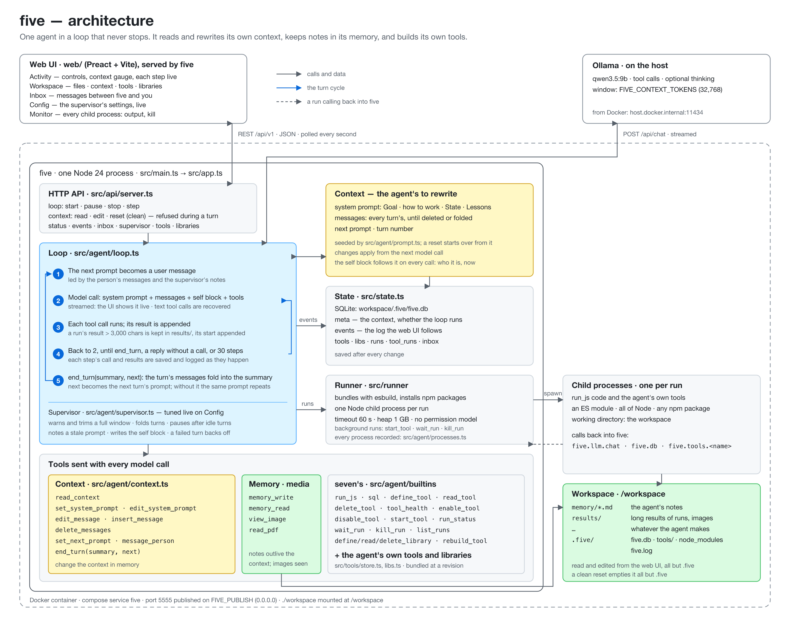

# five

An experimental self-modifying agent: one agent, in a loop that never stops,
that reads and rewrites its own context — system prompt included — and builds
its own tools. Line seven/nine's sibling, and the most minimal of them: one
agent, one context, one SQLite file, Ollama.

`docs/architecture.svg` is the source; `docs/architecture.png` is it rendered at 2×.

## How it works

| Part | What it does |
|---|---|
| The loop | Each turn appends the **next prompt** to the context as a user message and sends the whole context to the model. The model makes as many tool calls as it likes (up to `FIVE_MAX_STEPS` model calls); the turn ends when it calls `end_turn` or replies without a call. A turn that ends with a reply is folded into it, as `end_turn` folds one into its summary (`FIVE_FOLD_REPLIES`). The next turn starts with the prompt the agent set with `end_turn` or `set_next_prompt`, or the same one again. |
| The context | The system prompt, every message of every turn, and the next prompt. All of it is the agent's to change. Messages pile up until the agent deletes them, and Ollama silently drops the oldest text when the window (`FIVE_CONTEXT_TOKENS`) is full. |
| Guards | Five keeps out of the context but for these. When the last model call used more than `FIVE_CONTEXT_WARN` percent of the window, the turn's prompt starts with a warning to save to memory and delete messages, naming the one `delete_messages` call that drops every earlier turn. Above `FIVE_CONTEXT_TRIM` percent, the model can no longer make that call, so five drops the oldest messages itself, down to about half the window, and the turn's prompt says so. A turn that does no work — no tool call beyond `read_context`, `memory_read`, `set_next_prompt` and `end_turn` — makes the next prompt start with a note to get back to work, or to set a new goal if the old one is done; `FIVE_IDLE_TURNS` such turns in a row pause the loop. `set_next_prompt` and `end_turn` refuse a next prompt that repeats the turn's own, opens by reporting what is done ("Turn 22 complete…"), or waits for a user ("Awaiting user request…", "standby"): none ever answers. |
| Context tools | `read_context`, `set_system_prompt`, `edit_system_prompt`, `edit_message`, `insert_message`, `delete_messages`, `set_next_prompt`, `end_turn`. A change applies from the next model call. `end_turn(summary, next)` keeps the context in one call: the summary replaces every message of the turn, and `next` sets the next prompt. |
| Memory | `memory_write` and `memory_read`: notes the agent saves as `<workspace>/memory/<name>.md` and reads back in later turns — what outlives the context. The seed teaches it to start each turn with `memory_read` and save results as it goes. |
| seven's tools | `run_js`, `define_tool`, `read_tool`, `delete_tool`, `tool_health`, `disable_tool`, `enable_tool`, `start_tool`, `run_status`, `wait_run`, `kill_run`, `list_runs`, `sql` — and every tool the agent builds. A result of a run longer than `FIVE_RESULT_CHARS` is kept whole in `<workspace>/results/`, and the context gets its start and the file's path. Each run is its own Node.js child process with all of Node and npm, and **no permission model**. In a run, `five.llm.chat`, `five.db` and `five.tools.<name>` reach back into five. |
| The seed | A new or reset context starts from `src/agent/prompt.ts`: a system prompt with a goal (a 12-chapter novella, one chapter a turn), how to use its memory, an end-of-turn routine (save to memory, write lessons, `end_turn` with a summary and the next prompt), and empty `## State` and `## Lessons` sections. Edit it there, or edit the live system prompt in the UI. |
| The model | Ollama, `qwen3.5:9b` by default. Tool calls a small model writes as text are recovered. `FIVE_THINK=on` lets a thinking model think; the UI shows its thinking. |
| State | `<workspace>/.five/five.db`: the context, the event log, built tools, background runs, and whether the loop was running. A restart resumes the context, and resumes the loop if it was running; a turn cut off by the restart ends as `stopped`. |

## Web UI

Preact, with seven's and nine's design tokens, polling the API once a second.

| Page | Shows |
|---|---|
| Loop | Start / Pause / Step / Stop turn; model, turn and step; context-window meter; every turn live — its prompt, each model step (thinking, reply, tool calls with arguments and results), context changes, how it ended and the next prompt. |
| Context | The next prompt, the system prompt and every message, each editable, and messages deletable, while the loop is paused and no turn runs. **Start over** resets to the seed; its checkbox (on by default) also deletes the built tools and the workspace files. |
| Tools | The tools the agent built, with their parameters and source. |
| Processes | Every child process since five started — each `run_js`, each call of a tool the agent built (from a turn or from inside another run), each `define_tool` trial, each background run — newest first, with its turn and step, state and duration. One shows its error or result, its output (followed live), its arguments and its code; a live one can be killed. Kept in memory, the last 200 finished. |
| Workspace | The workspace's files, to read and edit (after nine's Data section). A text file up to 2 MB opens in an editor (⌘S saves); any file downloads; New file takes a path such as `notes/today.md`; Upload puts files in the directory shown; Delete removes a file, or a directory once empty. A SQLite database opens its tables: rows 100 at a time, Add row, Edit to change or delete one by rowid, and a SQL view that runs one statement. A file the agent changed since you opened it is not overwritten. `.five/` is not reachable. |

## Running

| How | Commands | UI |
|---|---|---|
| Docker, Ollama on the host | `make up` · `make logs` · `make down` | `http://<host>:5555` |
| Host, Node ≥ 24 | `npm ci && npm ci --prefix web && make start-host` | `http://127.0.0.1:5555` |

Under Docker all data lives in `./workspace`. Configuration is environment
only; `.env.example` lists every variable:

| Variable | Default | Meaning |
|---|---|---|
| `FIVE_OLLAMA_MODEL` | `qwen3.5:9b` | a pulled model with the tools capability |
| `FIVE_OLLAMA_ENDPOINT` | `http://localhost:11434` (Docker: `host.docker.internal`) | Ollama |
| `FIVE_CONTEXT_TOKENS` | `32768` | the window Ollama loads the model with |
| `FIVE_THINK` | `off` | let a thinking model think |
| `FIVE_MAX_STEPS` | `30` | model calls per turn |
| `FIVE_TURN_DELAY_MS` | `1000` | pause between turns |
| `FIVE_AUTOSTART` | `off` | start looping at startup even if it was paused |
| `FIVE_CONTEXT_WARN` | `60` | percent of the window above which a turn's prompt starts with a warning; `0` off |
| `FIVE_FOLD_REPLIES` | `on` | fold a turn that ends with a reply into that reply |
| `FIVE_CONTEXT_TRIM` | `85` | percent of the window above which five drops the oldest messages before a turn; `0` off |
| `FIVE_IDLE_TURNS` | `3` | turns in a row that do no work that pause the loop; `0` turns the guard and its note off |
| `FIVE_RESULT_CHARS` | `3000` | a run's result longer than this goes to a file, its start to the context; `0` never |
| `FIVE_RUN_TIMEOUT_MS`, `FIVE_RUN_MEMORY_MB` | `60000`, `1024` | limits of one code run |
| `FIVE_API_ADDR` | `127.0.0.1:5555` (Docker: `0.0.0.0:5555`) | where the API and UI listen |
| `FIVE_PUBLISH` | `0.0.0.0` | Docker: host interface port 5555 is published on |
| `FIVE_WORKSPACE` | current directory (Docker: `/workspace`) | where everything lives |
| `FIVE_LOG_LEVEL`, `FIVE_LOG_FILE` | `info`, `.five/five.log` | JSON-lines log, also on stderr |

## API

JSON over HTTP; writes need `content-type: application/json`.

| Method | Path | Does |
|---|---|---|
| GET | `/api/v1/status` | model, limits, loop state, token use, message and tool counts, last event seq |
| POST | `/api/v1/loop/start`, `/pause`, `/stop`, `/step` | control the loop; `stop` also ends the turn; `step` runs one turn while paused |
| GET | `/api/v1/context` | system prompt, next prompt, turn, messages |
| PUT | `/api/v1/context/system`, `/api/v1/context/next` | `{text}` |
| PUT, DELETE | `/api/v1/context/messages/:i` | edit `{content}`, or delete |
| POST | `/api/v1/context/reset` | seed context, turn 0, events cleared; `{"clean": true}` also deletes built tools and workspace files |
| GET | `/api/v1/events?after=<seq>` · `?turns=<n>` | the event log: after a seq, or the last n turns |
| GET | `/api/v1/turns/:n` | one turn's events |
| GET | `/api/v1/tools`, `/api/v1/tools/:name` | built tools |
| GET | `/api/v1/processes`, `/api/v1/processes/:id` | the child processes since five started, newest first; one with its code, arguments, output (the last 2000 lines) and result |
| POST | `/api/v1/processes/:id/kill` | kill a live one, and anything it spawned |
| GET | `/api/v1/workspace/files?path=` | one directory of the workspace, directories first |
| GET, PUT, DELETE | `/api/v1/workspace/file?path=` | a file's bytes (up to 32 MB, as `application/octet-stream` with a sandbox CSP; `&download=true` for an attachment); write one from an `application/octet-stream` body; delete a file or an empty directory. Its version is the `ETag`; with `If-Match`, a write or delete of a file changed since is `409`, and `If-Match: ""` creates only |
| GET | `/api/v1/workspace/db/tables?path=` | a database file's tables and views: columns, row counts, whether rows have a rowid |
| GET, POST, PUT, DELETE | `/api/v1/workspace/db/rows?path=` | a page of a table's rows (`&table=&offset=&limit=`, at most 500); insert `{table, values}`; change `{table, rowid, values}`; delete `&table=&rowid=` |
| POST | `/api/v1/workspace/db/sql?path=` | `{sql, args?}`: one statement; a read returns up to 1000 rows, a write `changes` and `lastInsertRowid`. `ATTACH` and `VACUUM INTO` are refused |

Context changes are refused (409) during a turn. Workspace paths are relative to the workspace; `..`, a link out of it, and `.five/` are refused.

## Layout

| Path | Holds |
|---|---|
| `src/agent/loop.ts` | the supervisor loop |
| `src/agent/processes.ts` | the record of every child process, around seven's runner |
| `src/agent/context.ts` | the context tools |
| `src/agent/prompt.ts` | the seed system prompt and first prompt |
| `src/agent/builtins/`, `src/runner/`, `src/tools/` | seven's tools, runner and tool store, copied |
| `src/llm/` | the Ollama client and text tool-call recovery, from seven |
| `src/state.ts` | the SQLite state |
| `src/api/` | the HTTP API, its shared types, and the workspace's files and databases (`workspace.ts`) |
| `web/` | the web UI |
| `test/` | `node:test` against a scripted model |
| `docs/` | the architecture diagram |

## Development

`make ci` (in the dev container) or `make ci-host`: typecheck, Biome, the tests,
and the web UI's typecheck. Nothing in the tests calls a model.

## Limits

- **No sign-in.** Docker publishes port 5555 on every interface: anyone who
  reaches it can drive the agent, and the agent runs arbitrary code.
  `FIVE_PUBLISH=127.0.0.1` keeps it local.
- **No context management by five.** Overflow is the agent's to prevent; five
  only warns it to save to memory and delete messages, and the UI shows the last call's prompt tokens against the
  window.
- **A clean reset refuses a workspace that is a git repository**, so running
  from the repo cannot delete it; it then deletes nothing.
- One five per workspace; nothing prevents a second.
